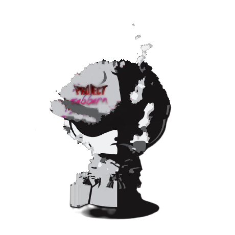

<div align="center">

# Background Remover

**Three ways to strip an image background — a Streamlit batch app, a desktop GUI and a fully client-side browser app. Every one of them runs on your own machine; no image is ever sent to an external API.**

Python · Streamlit · rembg (U2-Net) · CustomTkinter · React · ONNX Runtime



</div>

## Overview

A small suite of related tools built on the same idea — local, private background removal
with [rembg](https://github.com/danielgatis/rembg) — at three different levels of comfort:

| Tool | Path | Runtime | Best for |
| --- | --- | --- | --- |
| **Streamlit batch app** | `app.py` | Python | Many images at once, drag & drop, ZIP download |
| **Desktop GUI** | `desktop_app.py` | Python (CustomTkinter) | Whole folders, no browser, dark-mode native window |
| **Browser app** | `web_app/` | Node (build only) + a modern browser | Editing, manual refinement and background replacement |

The two Python tools process images on the local machine with U2-Net segmentation. The
browser app does the same work client-side with ONNX Runtime (WASM, WebGPU where available),
so it needs no Python install and no server at runtime.

## 1 · Streamlit batch app

```bash
python -m venv .venv
source .venv/bin/activate        # Windows PowerShell: .venv\Scripts\Activate.ps1
pip install -r requirements.txt
streamlit run app.py
```

Open the URL Streamlit prints (usually <http://localhost:8501>).

> The first run downloads the selected model (~170 MB for `u2net`) and caches it in
> `~/.u2net`. Later runs start instantly.

**Features**

- Drag & drop uploads for multiple images (`.png`, `.jpg`, `.jpeg`, `.webp`).
- Live status — per-image spinners plus an overall progress bar.
- Side-by-side previews of original vs. transparent result, on a checkerboard so
  transparency is visible.
- Individual **Download PNG** button per image, and a one-click **Download all (.zip)** in the
  sidebar.
- Settings for model, alpha matting and a max-dimension cap.
- Session caching — results survive Streamlit reruns, so an upload is processed exactly once
  per session.

**Usage** — drop images in, watch them process, compare, then download individually or as a
ZIP. **Re-run removal** reprocesses the current uploads after a settings change; **Clear
results** empties the workspace.

### Settings

| Setting | Description |
| --- | --- |
| Segmentation model | `u2net` (default), `isnet-general-use`, `u2netp` (fast), `u2net_human_seg`, `u2net_cloth_seg` |
| Alpha matting | Finer semi-transparent edges (hair, fur). Needs `pymatting` — uncomment it in `requirements.txt` |
| Max image dimension | Downscales inputs (aspect preserved) before inference; output matches that size |

### Limits

- Results are held in memory for the session; for very large batches, download and **Clear
  results** periodically.
- Animated inputs use their first frame.
- Each upload is capped at 25 MB (`MAX_FILE_BYTES` in `app.py`).
- Pillow's decompression-bomb guard applies to extremely large images.

## 2 · Desktop GUI

A standalone CustomTkinter alternative for whole folders:

```bash
pip install -r requirements.txt    # includes customtkinter
python desktop_app.py
```

- Dark-mode interface that follows CustomTkinter's theming.
- Pick an **input folder** (optionally including subfolders) and an **output folder**.
- **Start batch processing** runs on a background thread — the UI never freezes.
- Live progress bar with a completed-vs-total counter and a run log.
- **Stop** button with a safe shutdown mid-batch.
- Results are written as `<name>_no_bg.png`; existing files are never overwritten.

## 3 · Browser app

```bash
cd web_app
npm install
npm run dev        # http://localhost:5173
npm run build      # typecheck + static build in dist/
```

- **100% client-side** — the model is fetched once and cached by the browser; images never
  leave the device.
- **AI-powered** — ONNX Runtime with WASM, and WebGPU on capable devices.
- **Manual refinement** — erase/restore brushes, undo/redo, crop, edge smoothing.
- **Background replacement** — solid colours, custom images, drop shadows.
- **Clipboard paste** — <kbd>Ctrl</kbd>+<kbd>V</kbd> an image straight into the app.
- **Export** as PNG, JPEG or WebP with quality control.
- **Keyboard shortcuts** — press <kbd>?</kbd> in the app.

The build output in `dist/` is static and can be hosted anywhere. See
[`web_app/README.md`](web_app/README.md) for the deep dive.

### Browser app stack

| Layer | Choice |
| --- | --- |
| UI | React 19, TypeScript, Tailwind CSS |
| State | Zustand |
| Inference | `@imgly/background-removal` over ONNX Runtime |
| Build | Vite 7 |
| Tests | Vitest + Testing Library, Playwright for e2e |

```bash
cd web_app
npm run test:run        # unit tests
npm run test:coverage   # with coverage
npm run test:e2e        # Playwright
npm run lint            # ESLint
```

## Project layout

```
app.py                 Streamlit batch app (model selection, ZIP export, session cache)
desktop_app.py         CustomTkinter desktop GUI with folder batches and a run log
requirements.txt       Python dependencies for both
web_app/               React + ONNX browser app
  src/components/      Uploader, canvas viewer, toolbar, pickers, toasts, error boundary
  src/hooks/           Removal, brush, renderer, crop, cursor, export, shortcuts, touch
  src/services/        Model loading and inference
  src/store/           Zustand app and toast stores
  src/workers/         Removal worker
  src/utils/           Image resize and edge refinement
  e2e/                 Playwright specs
```

## Credits and licensing

The browser app in `web_app/` is derived from **zebbern**'s Background Remover project
([github.com/zebbern/backround_remover](https://github.com/zebbern/backround_remover)) and is
marked Apache-2.0 in its `package.json`; the original attribution is kept in the app's
metadata. Segmentation is provided by [rembg](https://github.com/danielgatis/rembg) (U2-Net)
and [@imgly/background-removal](https://github.com/imgly/background-removal-js).

No top-level licence file ships with this repository — add one before redistributing the
bundled tools, and keep the upstream notices for the browser app.
